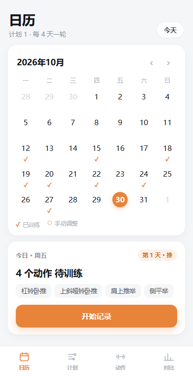
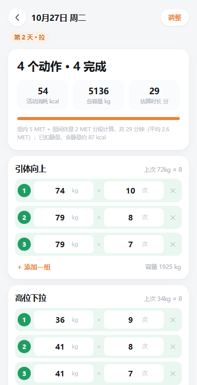
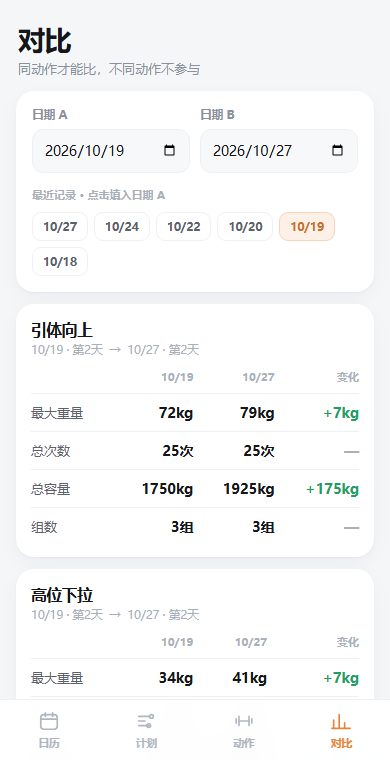

# 训练日志 · Training Log

> 一个不需要注册、不需要联网、数据只存在你自己手机里的健身记录 App。
> A single-file fitness tracker PWA + a tiny Android WebView wrapper. No backend, no account, no tracking — your data never leaves your phone.

网页版是一个 `index.html`（原生 JS，零依赖，约 110 KB），安卓版是一个 200 行的 WebView 壳，两者共用同一套前端代码。

<p align="center">
  <a href="https://bigyellowdick.github.io/training-log/"><b>▶ 在线使用</b></a> ｜
  <a href="https://bigyellowdick.github.io/training-log/TrainingLog-v1.0.1.apk"><b>⬇ 下载安卓安装包</b></a> ｜
  <a href="https://github.com/bigyellowdick/training-log/releases">Releases</a>
</p>

<p align="center">
  
  
  
</p>

---

## 为什么做这个

市面上的健身 App 大多要注册账号、同步云端、订阅会员。我只想要一件事：**今天该练什么、上次这个动作做了多重、这周比上周进步了吗。**

所以它长这样：

- 日历上练过的日子打 ✓，没练的就是空白
- 点进去直接填重量 × 次数，**不会自动帮你填上次的数字**（避免"假装完成了"）
- 想对比哪两天就对比哪两天，只比两边都有的动作

---

## 功能

### 训练计划
- **训练日 + 休息日自由组合**：不是固定的"练三休一"，循环顺序可以任意排布（练-练-休-练-休 也行），最多 16 个位置
- **多套计划**：计划 A / B / C 并存，随时切换
- **组合套餐**：内置 8 种常见排法（推拉腿、上下肢、五分化……）一键套用
- **某天临时改**：这天休息 / 这天改成练第 N 天 / 跨计划导入另一套计划的某一天
- **计划变了不丢记录**：换计划后旧记录归入"计划外"折叠区，不会被当成今天的任务；把动作加回计划，旧记录自动认领

### 记录
- 每个动作记录多组「重量 × 次数」，自动算总容量
- 显示「上次 X kg × N 次」作参考，**但输入框始终是空的**
- **自建动作**：动作库右上角、列表底部、当日记录页三处入口，都能现场新建
- 日历已训练的日子显示橙色 ✓，不区分深浅色

### 对比
- 任选两天对比同一个动作的最大重量、总次数、总容量、组数
- 只对比**两边都有**的动作，只有一边有的标注为「无法对比」

### 热量估算
- 采集体重（必填）、身高、体脂率、年龄、性别，估算每次训练的活动消耗
- 详见下方[算法说明](#热量怎么算的)

### 数据安全
- 全部数据存 `localStorage`，关掉 App、重启手机、更新版本都不会丢
- 安卓版额外落一份 `autosave.json` 自动存档，网页数据读不出来时自动回滚
- 一键导出 / 导入 JSON 备份，换手机时可完整迁移
- 读坏数据时**锁写保护**：不会用空数据静默覆盖你的记录

---

## 快速开始

### 一、网页版（最简单）

```bash
git clone https://github.com/bigyellowdick/training-log.git
cd training-log
# 用任意静态服务器打开 fitness/index.html
python3 -m http.server 8000 --directory fitness
```

然后浏览器访问 `http://localhost:8000`。手机上同理，用手机浏览器打开你的部署地址即可。

> 直接双击 `fitness/index.html` 也能用，但 `file://` 下 Service Worker 不会注册（无离线缓存），建议还是起个本地服务器。

**装到手机主屏幕（PWA）**
- Android Chrome：右上角菜单 →「添加到主屏幕」
- iOS Safari：分享按钮 →「添加到主屏幕」

装好后是全屏的，没有地址栏，断网也能记录。

### 二、安卓 APK

不需要 Gradle，也不需要 Android Studio，只要 JDK + Android SDK 的 build-tools：

```bash
cd android-build
# 把 Android SDK 放到 android-build/sdk，或用 ANDROID_HOME 指定：
#   sdk/bt/android-14/          <- build-tools
#   sdk/pf/android-34/android.jar
ANDROID_HOME=/path/to/sdk ./build.sh
```

首次运行会自动生成签名密钥（`build/fitlog.jks`），产物在仓库上一级目录。
可覆盖的环境变量：`ANDROID_HOME`、`BUILD_TOOLS`、`PLATFORM`、`KEYSTORE_PASS`、`VERSION_NAME`。

> ⚠️ `.jks` 是你的签名私钥，已在 `.gitignore` 里排除。**千万不要提交它**——泄露后别人可以伪造你的 App 更新。

---

## 目录结构

```
.
├── fitness/                    # 网页版（PWA）
│   ├── index.html              # 全部逻辑：UI + 路由 + 数据层 + 算法
│   ├── manifest.webmanifest    # PWA 清单
│   ├── sw.js                   # Service Worker（HTML 网络优先，静态资源缓存优先）
│   └── icon-192.png / 512
├── android-build/              # 安卓壳
│   ├── build.sh                # 一键打包（aapt2 → javac → d8 → zipalign → apksigner）
│   └── app/
│       ├── AndroidManifest.xml
│       ├── java/com/fitlog/training/MainActivity.java
│       └── res/                # 图标与主题
└── docs/                       # 截图
```

---

## 技术说明

### 单文件前端
整个前端是一个 `index.html`：内联 CSS + 原生 JS，没有构建步骤、没有 npm 依赖、没有框架。改完刷新就生效。

- 路由是内存里的 `route = { name, params }` + 整体重渲染，事件全部委托到 `#app`
- 样式按 440px 宽的手机视口设计，桌面打开是居中的手机画布
- 所有状态在 `state` 对象里，写入 `localStorage['fitlog_v1']`

### 数据模型

```js
{
  actions: [{ id, name, group, custom }],   // 动作库
  plans: [{                                 // 多套计划
    id, name, startDate, trainDays, restDays,
    days: [{ name, actionIds: [] }],        // 训练日"内容库"（最多 12，下标即第几天）
    slots: [                                // 循环顺序（最多 16）
      { t: 'train', d: 0 }, { t: 'rest' }, { t: 'train', d: 1 }
    ]
  }],
  activePlanId,
  logs: {                                   // 按日期存
    'YYYY-MM-DD': {
      entries: [{ actionId, sets: [{ w, r }], extra? }]  // extra = 计划外
    }
  },
  overrides: { 'YYYY-MM-DD': { type, planId, dayIndex } },  // 单日手动安排
  profile: { height, weight, bodyFat, sex, age, restSec }
}
```

**训练日内容与循环顺序是解耦的**（`days[]` vs `slots[]`）。这是这个项目的关键设计：同一个"腿部日"可以在一个循环里出现两次，调整顺序也不会丢动作。旧版本的数据通过 `migrate()` 自动升级，一条不丢。

### 热量怎么算的

不编数字，全部有出处：

| 环节 | 依据 |
|---|---|
| 抗阻训练强度 | 2024 Adult Compendium of Physical Activities：02054 = 3.5 MET（多动作 8–15 次）、02052 = 5.0、02050 = 6.0 |
| 组间休息 | 2.0 MET（静坐） |
| 换动作间隙 | 2.5 MET |
| 基础代谢 | 有体脂率 → Katch-McArdle（370 + 21.6 × 去脂体重）；无 → Mifflin-St Jeor |
| 1 MET 换算 | ≈ BMR / 24（kcal/min = MET × BMR ÷ 1440） |

**分三段计时**，不是把整节课都按训练强度算：

```
组内收缩  workMin = Σ min(90, max(15, 次数 × 3)) / 60   →  3.5 / 5.0 / 6.0 MET
组间休息  restMin = (组数 - 1) × 休息秒数 / 60          →  2.0 MET
动作间隙  transMin = (动作数 - 1) × 150 / 60            →  2.5 MET
```

显示的是**净消耗**（扣掉同期静息代谢），也就是"因为训练而多烧掉的那部分"。

这个实现修过一个真实的 bug：早期版本把全部时长（含坐着休息）都乘了训练 MET，导致"休息越久消耗越多"——90 秒改 180 秒会凭空多出 74 kcal。现在休息时间只按 2.0 MET 计，同样的改动只增加约 19 kcal，这才是合理的。

误差约 ±30%，够用就好，不要拿它当医学依据。

### 安卓壳
`MainActivity` 只有两百来行：一个 WebView 加载 `file:///android_asset/index.html`，加几座 JS 桥：

- `autoSave / hasAutosave / getAutosave` — 自动存档落盘、启动时兜底恢复
- `saveBackup / pickBackup` — 导出备份写入系统「下载」目录、导入走系统文件选择器
- 自己实现 `onJsAlert / onJsConfirm`（WebView 默认把 `confirm()` 当取消）
- 返回键回日历，再按退出

---

## 已知限制

- **数据不跨设备同步**。这是刻意的设计（不要服务器、不要账号），迁移靠导出/导入 JSON。
- **APK 与网页版是两套独立存储**，通过备份文件互通。
- **iOS 无法侧载**。想上 iPhone 只能用网页版「添加到主屏幕」，且 iOS 的网页存储可能被「清除网站数据」清掉，记得定期导出。
- 热量是估算，不是测量。
- 只支持单用户、单设备视角，没有社交、没有排行榜、没有云同步。

## 欢迎 PR

比较想补的方向：多语言、深色模式、动作的器械/肌群分类、训练容量趋势图。

## License

[MIT](LICENSE)
